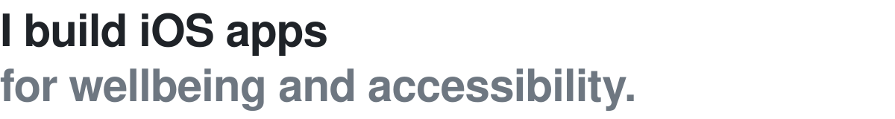
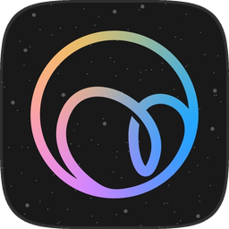
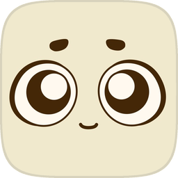

<picture>
  <source media="(prefers-color-scheme: dark)" srcset="assets/header-dark.svg">
  
</picture>

I'm Muhammad Zhafran, a designer and iOS developer from Palembang, Indonesia. I start with user research, design in Figma against Apple's Human Interface Guidelines, build in Swift and SwiftUI, and test with real people on TestFlight.

### On the App Store

  
  <strong><a href="https://apps.apple.com/id/app/buzzle-buzzing-bubble/id6751494932">Buzzle</a></strong> 
  A mindfulness app where each tapped sphere pops with Core Haptics. I led the design and built its SpriteKit physics. On iPhone, Mac, and Vision Pro. <a href="https://github.com/utaridyani/teamHealth-CH4">Source</a>

 

  
  <strong><a href="https://apps.apple.com/id/app/sugoy/id6755243073">Sugoy</a></strong> 
  A sugar companion with a 365-day intake calendar and home screen widgets, built with WidgetKit and App Intents, so you can log a snack without opening the app.

 

### Earlier work

**[Catatmak](https://github.com/zuppdev/Catatmak-AIML-Portfolio)**: an expense tracker that reads informal Indonesian (“makan bakso 20k”), receipt photos, and voice notes. I co-founded it and designed its design system and V2 interface. It reached 300+ downloads and received $10,000 in incubation funding from Google and Indonesia's Ministry of Education.

**[Agrease](https://github.com/zuppdev/agrease)**: a Flutter app that detects 15 crop diseases from a photo, on device with TensorFlow Lite, at 85%+ accuracy. Top 100 globally in the Google Solution Challenge 2023.

**Akson**: an assistive app for children with autism and dyslexia, with an AI chatbot and a consultation system, built with Flutter and Firebase. I was the team's researcher. Top 20 finalist at GEMASTIK XVI, and an Indonesian patent (HKI).

### Experience

**PT Fluent Staff**, Chief Technology Officer (contract), Feb-Aug 2026 
Took a language learning platform for hospitality staff from idea to product. Led a designer and a backend engineer, added Midtrans payments, and built an AI-assisted iOS release pipeline with Claude.

**Apple Developer Academy @ BINUS**, Research, Design & iOS Development, Mar-Dec 2025 
User research through Challenge Based Learning, designs in Figma, builds in Swift, SwiftUI, and UIKit, and two apps shipped with Xcode Cloud.

**LPPM UNSRI**, Front End Developer & Designer, Dec 2024-Feb 2025 
Designed and built a Next.js web app for 7,000+ users, connected to 750+ REST endpoints.

**Google Developer Groups on Campus UNSRI**, Mobile Development Core Team, 2023-2024 
Ran Flutter and TensorFlow workshops and mentored 8 members.

**Universitas Sriwijaya**, Bachelor of Computer Science in Informatics Engineering, GPA 3.79, 2021-2025 
Bangkit Academy 2023: Best Capstone Project among 3,000+ participants, and 1st place in the Elevator Pitch challenge.

 

Open to product design and iOS roles. 
[zupp.dev](https://zupp.dev) &nbsp;/&nbsp; [LinkedIn](https://linkedin.com/in/zfrn) &nbsp;/&nbsp; [Email](mailto:zxxfrn@gmail.com)
